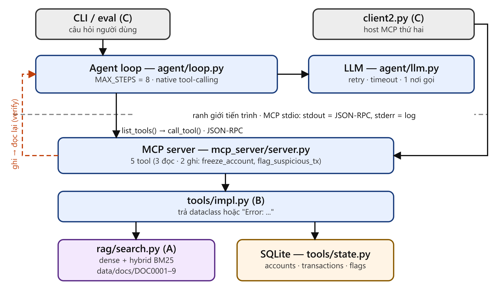

# TRFC Agent — Trợ lý Kiểm soát Rủi ro & Gian lận Giao dịch

## §1 — Vấn đề, phạm vi, giả định

### 1.1 Bài toán

Chuyên viên Risk & Compliance phải trả lời liên tục hai câu: *giao dịch này có vi phạm quy định
không*, và *nếu có thì làm gì ngay*. Hiện làm thủ công: mở file quy định, đối chiếu hạn mức theo
tầng eKYC, cộng dồn giá trị trong ngày, rồi quyết định khoá tài khoản hay đánh dấu giao dịch. Ba
điểm yếu: (1) không truy được câu trả lời về **đúng điều khoản và đúng phiên bản**; (2) cộng dồn
theo ngày dễ sai, không lặp lại được; (3) quyết định không để lại dấu vết nên không kiểm toán được.

TRFC Agent biến quy trình đó thành vòng lặp có bằng chứng: **tra cứu → tính/so sánh → hành động →
tự kiểm chứng**. Mọi kết luận truy được về `doc_id`, mọi hành động có bước đọc lại chứng minh.
Người dùng là **chuyên viên Risk & Compliance nội bộ** đã biết nghiệp vụ, cần công cụ tăng tốc và
tạo dấu vết — **không phải** khách hàng cuối hay chatbot tư vấn chung.

### 1.2 Hệ thống làm gì

1. **Tra cứu có trích dẫn** — `[Source: <doc_id>, chunk <n>]`; `Chunk` mang `version` và `tier`
   nên phân biệt được DOC0003 (2025.2) với DOC0007 (2026.1).
2. **Biến đổi** — cộng dồn giao dịch trong ngày, tính % vượt hạn mức theo tầng, đối chiếu quy tắc
   bất khả thi địa lý, phát hiện mâu thuẫn giữa hai phiên bản tài liệu.
3. **Hành động + verify** — gọi tool ghi (`freeze_account_temporarily`, `flag_suspicious_tx`) rồi
   **bắt buộc** đọc lại bằng `get_account_risk_status` để chứng minh trạng thái đã đổi.
4. **Từ chối có phân loại** — (i) ngoài phạm vi tài liệu; (ii) có quy định nhưng thiếu dữ liệu để
   suy luận.

### 1.3 Hệ thống KHÔNG làm gì

- **Không chạy thời gian thực, không nối core banking thật.** Không streaming hay job nền; mỗi câu
  hỏi là một lượt chạy độc lập do người dùng khởi phát, dữ liệu giao dịch là SQLite mô phỏng
  (`data/state.db`).
- **Không tự động khoá tài khoản trong production.** Tool ghi chỉ chạy khi
  `TRFC_REQUIRE_ISOLATED_DB=1` và `TRFC_STATE_DB` trỏ ra ngoài repo; DB production đối soát SHA256
  trước/sau mỗi lần chạy.
- **Không phong toả vĩnh viễn, không ra quyết định pháp lý, không thay người ký duyệt** — hành
  động tối đa là *khoá tạm thời* và *đánh dấu giao dịch*. Câu hỏi ngoài 9 tài liệu phải bị từ chối.

### 1.4 Giả định

- 9 tài liệu trong `data/docs/` là bản hiện hành, trừ DOC0003 (2025.2) đã bị DOC0007 (2026.1) thay
  thế. Hệ thống **không** tự loại DOC0003 khỏi index — để tầng suy luận chọn bản mới hơn theo
  `version`/`date` (hệ quả xem §7.1).
- `tier` eKYC lấy từ `accounts.ekyc_tier`, không suy ra từ lịch sử giao dịch; một tài khoản thuộc
  đúng một tầng tại một thời điểm. Câu hỏi là tiếng Việt hoặc tiếng Anh.

## §2 — Kiến trúc tổng thể



*Hình 2.1.* Mũi tên đứt nét cam là cặp **ghi → đọc lại (verify)**: agent gọi `freeze_account_temporarily` xong bắt buộc gọi `get_account_risk_status` để chứng minh trạng thái đã đổi. Nguồn hình: `scripts/make_arch_figure.py` (sinh `reports/architecture.svg` + `.png`).

Bốn ranh giới: người dùng ↔ agent; agent ↔ LLM (chỉ qua `call_llm()`); agent ↔ tool (qua MCP stdio, tách tiến trình); tool ↔ trạng thái (chỉ `state.py` mở SQLite).

Luồng một câu hỏi mẫu (q05): `search_policy` → `freeze_account_temporarily` → `get_account_risk_status` (verify). Agent và `client2.py` cùng đi vào **một MCP server**, server gọi **cùng `tools/impl.py`**, nên tool hành xử giống nhau ở mọi đường gọi.

| Khối | Người | Giao diện |
|---|---|---|
| RAG | A | `search_policy(query, k, tier, mode) -> list[Chunk]` |
| Agent + Tool + MCP | B | 5 tool qua MCP; `AgentRunResult` cho eval |
| Eval + Log | C | gọi `run_detailed()`, đọc `tool_trace`, `usage` |

## §3 — Thiết kế RAG

### 3.1 Corpus

9 tài liệu tự soạn trong `data/docs/`, frontmatter `doc_id` / `title` / `version` / `date` /
`owner`. **Tổng 16.293 token** (`tiktoken`, `cl100k_base`) — vượt mốc 10.000 của syllabus.

| `doc_id` | Tiêu đề | `version` | `date` | `owner` |
|---|---|---|---|---|
| DOC0003 | Hạn mức giao dịch theo tầng eKYC (**bản cũ, đã bị thay thế**) | 2025.2 | 2025-08-01 | Risk |
| DOC0004 | Quy tắc phát hiện giao dịch bất thường | 2026.1 | 2026-01-10 | Risk |
| DOC0007 | Hạn mức giao dịch theo tầng eKYC | 2026.1 | 2026-01-15 | Risk |
| DOC0008 | Quy trình xử lý và khoá tài khoản rủi ro | 2026.1 | 2026-01-20 | Compliance |
| DOC0009 | Danh mục phương thức thanh toán trong phạm vi kiểm soát | 2026.1 | 2026-02-01 | Risk |

Bốn tài liệu còn lại (DOC0001, 0002, 0005, 0006) cùng khuôn metadata, `owner` là Risk hoặc
Operations.

### 3.2 Chunking — và lý do

**Structural**: cắt theo Chương → Điều → Khoản; `chunk_size=400`, `overlap=50` đọc từ
`config.toml` (`chunking.py:142-144`). Kết quả **61 chunk gốc** (trung bình 305 token, trung vị
320, lớn nhất 421) + 6 view tầng (§3.4) = 67 vector.

1. **Cấu trúc phân cấp sẵn** — cắt theo `Điều`/`Khoản` giữ nguyên đơn vị ngữ nghĩa; fixed-size cắt
   giữa câu và làm mất chủ thể điều khoản.
2. **Bảng hạn mức phải nguyên khối** — bảng cắt vỡ có thể giữ "hạn mức 500 triệu/ngày" mà mất dòng
   "áp dụng cho tầng eKYC 2": số đúng nhưng gán sai tầng, **lỗi im lặng** không crash.
   `chunking.py:169` giữ khối atomic kể cả khi vượt `chunk_size` (chunk bảng DOC0007 = 421 token —
   cố ý).
3. **`overlap=50`** bắc cầu đoạn văn dài qua ranh giới Điều; carry theo *segment* trọn vẹn nên
   bảng atomic không bị hỏng. **`chunk_size=400`** đủ chứa 1 Điều trung bình, giữ 3–5 chunk trong
   context.

Mỗi chunk mang **heading path prefix** (`"Điều 5 > Khoản 2"`) để đứng một mình vẫn có ngữ cảnh vị
trí; **dòng giới thiệu ngay trên bảng gộp vào khối bảng** (`chunking.py:75-79`).

### 3.3 Embedding và hai chế độ truy vấn

- **Backend**: `OPENAI_API_KEY` → `text-embedding-3-small`; `JINA_API_KEY` → `jina-embeddings-v3`;
  không có key → **offline hashing** (`embed.py:124`, md5 token vào 1024 chiều, L2-normalize).
  Backend chốt một lần cho cả run (`_probe()`); probe lỗi thì hạ xuống offline kèm cảnh báo stderr
  thay vì chết giữa demo.
- **Ngưỡng và hợp đồng trả về**: cosine, `MIN_SCORE=0.45` (API) / `MIN_SCORE_OFFLINE=0.10`
  (hashing) — hai backend hai thang điểm. Top-K = 5; không đạt ngưỡng trả `[]`, **không bao giờ**
  `None`, để agent phân biệt "không tìm thấy" với "lỗi tool".
- **Hai chế độ** (`retrieval.mode`, mặc định `hybrid`): `dense` xếp theo `cosine`; `hybrid` theo
  `0.3 × BM25_norm + 0.7 × cosine`. Truy vấn chứa **mã định danh** ("DOC0007", "PM03") thì BM25
  thắng vì embedding làm mờ token hiếm; câu **diễn đạt tự nhiên** thì dense thắng vì không trùng
  mặt chữ. Trọng số nghiêng dense nhưng vẫn giữ BM25 để bắt mã tài liệu.
- **Ngưỡng chỉ áp lên cosine**, không áp lên điểm fuse (`search.py:61-65`): fuse là thang **tương
  đối** phụ thuộc phân bố BM25 từng truy vấn — ngưỡng để **chặn**, fuse để **xếp hạng**.

### 3.4 Metadata filter `tier`

`tier` là metadata **mức dòng**, đơn vị index là **chunk**, mà chunk bảng DOC0007 chứa cả 3 tầng —
gắn `tier` lên chunk thì không giá trị nào đúng, còn lọc sau rank thì `tier=2` vẫn trả nguyên bảng
kèm hạn mức tầng 1 và 3.

**Cách giải — "view một tầng".** Mỗi dòng `| Tầng N | ... |` sinh một view (`store.py:53`): cùng
`doc_id`/`chunk_index`, text chỉ giữ dòng tiêu đề bảng và dòng tầng N. View được embed và đánh BM25
cùng lúc với chunk gốc (`store.py:83`) nên hai chế độ dùng chung thứ tự index. DOC0003 + DOC0007 →
6 view, mỗi tầng đúng **2 ứng viên**.

Ghi chú: `tier` không có trong frontmatter doc nào — nó là metadata **sinh ra lúc index**.

**Pre-filter, không phải post-filter** (`search.py:55`): `store.rank_candidates(tier)` trả index
của toàn bộ chunk gốc khi `tier=None`, hoặc chỉ view tầng N khi có `tier`; `dense_scores` chỉ tính
trên tập đó. Chunk sai tầng **không bao giờ** vào top-K kể cả khi khớp từ khoá tốt hơn, trong khi
post-filter để chunk sai tầng chiếm slot top-5 và đẩy chunk đúng ra ngoài.

**Giới hạn, nói thẳng:** testset hiện có **0 câu** truyền `tier` (`grep -c '"tier"'
tests/testset.jsonl` → `0`). `tier` là **năng lực có thật của tool** nhưng **chưa có bằng chứng
eval**, nên báo cáo **không claim điểm cộng +1 metadata filter**.

### 3.5 Dense vs hybrid — số đo

Đo bằng cách gọi thẳng `search_policy(question, k, mode=...)` trên 12 câu của `tests/testset.jsonl`
và so với trường `must_cite` của từng câu. Không đi qua LLM — đây là **số của tầng truy vấn**, không
phải số của toàn pipeline.

| Cấu hình | recall@1 | recall@3 | recall@5 | context precision |
|---|---|---|---|---|
| `mode="dense"` | 11/12 | 11/12 | 11/12 | 0.40 (chấm được 2/12 câu) |
| `mode="hybrid"` (`0.3*BM25 + 0.7*cosine`) | 10/12 | 12/12 | 12/12 | 0.80 (chấm được 1/12 câu) |

Đọc bảng này cho đúng:

- **Hybrid thắng ở recall@3 và @5** (12/12 so với 11/12): câu duy nhất dense trượt là `q09` — gold
  `DOC0009`, dense trả `DOC0007` bốn lần rồi `DOC0003`, tức là BM25 kéo đúng tài liệu vào top-3.
  Ở top-1 thì ngược lại, hybrid trượt `q01` (gold `DOC0007`, trả `DOC0003`) và `q09`, dense chỉ trượt
  `q09` — nên **không kết luận được hybrid tốt hơn ở top-1** với 12 câu.
- **`context precision` chỉ chấm được 1–2/12 câu**, nên 0.40 và 0.80 là trung bình của 2 và 1 điểm dữ
  liệu — **không đủ để so sánh hai cấu hình**. Lý do: `eval/metrics.py:73` trả `None` (không chấm) khi
  một context chứa nhiều hơn một mã `DOCnnnn`; phần lớn chunk trích dẫn chéo tài liệu khác nên bị loại.
- **`faithfulness` = `Unscorable` cho cả hai cấu hình** — nó cần câu trả lời của LLM và trường `claims`,
  mà phép đo này không gọi LLM (§6.2).
- **Cả hai cấu hình chạy trên backend embedding `offline-hashing`** (md5 theo token, 1024 chiều), vì
  lần đo không có API key trong môi trường. Đây **không phải** số của lần chạy staging
  `staging_20261017_201308`. Log staging **không ghi** backend embedding nào đã dùng, nên không đối
  chiếu được hai lần chạy; muốn số của cấu hình API thật thì phải chạy lại với key.

## §4 — Thiết kế Agent & tool

**4.1 Schema bằng `@dataclass`** (`tools/schemas.py`; GV kiểm `grep -n "@dataclass"`). Không dùng dict thô vì sai tên trường chỉ lộ khi chạy.

```python
@dataclass
class Chunk:
    doc_id: str; title: str; version: str
    chunk_index: int; text: str; score: float; tier: int | None = None

@dataclass
class RiskStatus:                      # kết quả bước VERIFY
    account_id: str; frozen: bool
    freeze_reason: str | None; frozen_at: datetime | None
    flagged_tx_ids: list[str] = field(default_factory=list)
    checked_at: datetime = field(default_factory=datetime.utcnow)
```

`Transaction` và `Ack` cùng file. `checked_at` chứng minh lần đọc là **mới**, không phải phản hồi của lệnh ghi.

**4.2 Năm tool**

| Tool | Loại | Chữ ký | Trả về |
|---|---|---|---|
| `search_policy` | đọc | `(query, k=5, tier=None, mode="hybrid")` | `list[Chunk]` (uỷ quyền cho A) |
| `get_transactions` | đọc | `(account_id, date_from, date_to)` | `list[Transaction]` |
| `get_account_risk_status` | đọc, verify | `(account_id)` | `RiskStatus` |
| `freeze_account_temporarily` | **ghi** | `(account_id, reason)` | `Ack` |
| `flag_suspicious_tx` | **ghi** | `(tx_id, reason)` | `Ack` |

**4.3 Mô tả tool như prompt.** Model chọn tool qua docstring mà MCP trả về:

```python
"""Lệnh ghi Side-Effect: Tạm thời khóa tài khoản và ghi nhận lý do vào state.db."""   # freeze
"""Lệnh ghi Side-Effect: Đánh dấu cờ giao dịch nghi vấn vào state.db."""             # flag
```

Hai docstring nêu tool làm gì; điều kiện dùng (chỉ ghi khi được yêu cầu rõ, bắt buộc verify sau ghi, tra cứu tối đa 2 lần) nằm ở `prompts/system.txt` quy tắc 4–6. Ở cả 2 ca ghi trong log (q05, q06), model gọi đúng một tool ghi rồi gọi verify.

**4.4 Vòng lặp.** Tự viết, không LangChain, dùng native tool-calling qua MCP: `call_llm` → có `tool_calls`? → kiểm tool đã discover, args là JSON object, khớp `input_schema` → `session.call_tool()` → ghi `tool_trace` và thêm message `role=tool` → lặp; không có `tool_calls` thì trả câu trả lời cuối. Tool được discover động bằng `list_tools()` (`loop.py:661`; nhánh text ReAct ở `loop.py:522`). Tool riêng `submit_decision` do runtime xử lý, không gửi sang MCP. `search_policy` quá 2 lần thì loop bảo tổng hợp (`loop.py:788`, guard ở `:794`; nhánh text ReAct `loop.py:589`). JSON giả lập tool call nằm trong nội dung câu trả lời không bao giờ bị thực thi (có test). `parse.py` là bộ parse JSON chịu lỗi có test, không nằm trên đường chạy chính.

**4.5 `MAX_STEPS = 8`.** Đọc từ `config.toml` (`load_max_steps`, `loop.py:107`). Đơn vị là số lượt gọi model; 12 câu staging dùng 2–5 lượt, nên 8 còn dư 3. Hết bước: `status="failed"`, `error="Native tool loop exceeded MAX_STEPS (8)"` (`loop.py:821`; nhánh text ReAct `loop.py:617`), `run()` trả chuỗi `"Error: ..."` (`loop.py:865-866`), không raise, `tool_trace` được giữ lại. Test `test_maximum_model_turns_is_enforced`.

**4.6 Xử lý lỗi.** Lỗi là dữ liệu quan sát, không phải ngoại lệ, vì exception sẽ kết thúc run và mất trace; trả chuỗi thì model đọc lỗi và sửa ở lượt sau.

| Tầng | Cơ chế |
|---|---|
| Tool (`impl.py`) | bắt mọi exception, trả `"Error: ..."` |
| MCP → loop (`loop.py:241-263`) | `_tool_output()` giải mã chuỗi JSON, `json.loads` ở `:256`, bắt `JSONDecodeError`/`TypeError` ở `:257-258`, nhận diện `"Error:"` ở `:259-261`, đánh dấu `status="error"` |
| Loop (`loop.py:336`, `:341`, `:609`, `:811`) | tool lạ, args hỏng, sai schema → `"Tool error: ..."`, không thực thi tool |
| Parse (`parse.py`) | JSON hỏng → `"Error: Failed to parse action JSON ..."` |

Chạy thật (MCP stdio, DB tạm, 17/10/2026): `get_account_risk_status("NOPE")` → `"Error: Account NOPE not found in system."`; `flag_suspicious_tx("TX999", ...)` → `"Error: Transaction TX999 not found."`. Log staging không có bước lỗi nào, nên ví dụ lỗi cứu cả run mới có ở mức tool/MCP và test (`test_malformed_arguments_and_unknown_tool_are_returned_as_errors_without_execution`, model giả).

**4.7 `call_llm`** (`agent/llm.py:206`, nơi duy nhất gọi `client.chat`): `temperature=0`, timeout mặc định 30 s (`LLM_TIMEOUT_SECONDS`), tối đa 3 lần thử. Backoff `2·2^(lần−1)` giây cộng jitter, trần 60 s. Với 429: ưu tiên `Retry-After`, bỏ cuộc nếu phải chờ > 90 s. Không retry khi 413, hết quota, 401/403. Lỗi cuối là `LLMRequestError(message, calls)`; loop vẫn trả kết quả kèm `usage`. Prompt nằm trong `prompts/*.txt`. Hạn chế: `status_code` dùng để phân loại lỗi, dòng log stderr chỉ in tên lớp lỗi.

**4.8 Side effect thật và verify.** Freeze chạy `UPDATE accounts SET frozen=1, freeze_reason=?, frozen_at=?`; flag cập nhật `transactions.flagged` và `INSERT OR REPLACE INTO flags`. Không tool nào trả `"OK"` giả. `get_account_risk_status` mở kết nối mới, đọc lại từ DB và gắn `checked_at = now()`. `write_verification_status` (`loop.py:369`) xác nhận freeze khi lần đọc sau có `frozen=True` và `checked_at > frozen_at` (logic ở `loop.py:398-415`, so sánh ở `:404`), xác nhận flag khi `tx_id ∈ flagged_tx_ids`; ghi thành công mà không có lần đọc xác nhận thì quyết định bị từ chối (`loop.py:460`).

Trace thật q05 (`logs/staging_20261017_201308/step_events.jsonl`, `execution_mode=real`; `account_id` và `reason` bị che `[REDACTED]`, q05 hỏi ACC001):

| Step | Action | Args | Observe (rút gọn) |
|---|---|---|---|
| 1 | `search_policy` | `query="tỷ lệ vượt hạn mức ngày công thức DOC0007 … eKYC tầng 2"`, `k=5` | `DOC0007` v2026.1, chunk 7, Điều 10 (công thức) |
| 2 | `freeze_account_temporarily` | `account_id=[REDACTED]`, `reason=[REDACTED]` | `ok=true`, … vượt hạn mức 44% theo DOC0007 Điều 10 |
| 3 | `get_account_risk_status` | `account_id=[REDACTED]` | `frozen=true`, `frozen_at=…13:14:25.705Z`, `checked_at=…13:14:27.590Z` |

`checked_at` muộn hơn `frozen_at` khoảng 1,88 s. Không có cột thought vì native tool-calling không sinh thought dạng text. Cả run: `calls=5`, `prompt_tokens=23557`, `completion_tokens=982`, `max_prompt=5430`. Ca flag q06 cùng cấu trúc (`search_policy` DOC0004 → `flag_suspicious_tx` → verify; `calls=5`, 22637 / 987 / 5167); `semantic_gate_result.json` báo freeze và flag đều write + verify thành công (`PASS`).

Chứng minh agent dùng kết quả tool: (1) câu trả lời q05 nêu `frozen_at = 2026-10-17T13:14:25Z`, mốc do DB sinh lúc chạy, model không biết trước; (2) `contexts` chỉ lấy từ chunk `search_policy` thật sự trả về, `policy_rule_id` chỉ nhận nếu điều luật đó đã được truy hồi (`loop.py:467-470`); (3) thiếu verify thì quyết định bị từ chối.

**4.9 Guard an toàn.** `require_isolated_database_for_writes()` (`tools/state.py`) chạy trước khi mở SQLite và chỉ cho ghi khi `TRFC_REQUIRE_ISOLATED_DB=1` và `TRFC_STATE_DB` là đường dẫn tuyệt đối khác `data/state.db`; vi phạm thì tool trả `"Error: ... Write operation blocked ..."`. Tiến trình MCP con chỉ nhận hai biến này, không nhận khoá API. Test: `tests/test_db_isolation.py`.

## §5 — MCP server

Server `MCPServer("TRFC Risk & AML Server")`, transport **stdio**, 5 tool trong đó **2 tool ghi** (`server.py:89-95` freeze, `server.py:97-103` flag). Mỗi tool gọi hàm cùng tên trong `impl.py` rồi `json.dumps`; không có logic nghiệp vụ thứ hai.

| Tool | Loại | Tham số |
|---|---|---|
| `search_policy` | đọc | `query`, `k`, `tier`, `mode` |
| `get_transactions` | đọc | `account_id`, `date_from`, `date_to` |
| `get_account_risk_status` | đọc (verify) | `account_id` |
| `freeze_account_temporarily` | **ghi** | `account_id`, `reason` |
| `flag_suspicious_tx` | **ghi** | `tx_id`, `reason` |

**Stdout sạch.** Stdio dùng stdout làm kênh JSON-RPC; một `print()` debug chen vào giữa frame làm client parse hỏng và cả phiên chết. Vì vậy logging gắn `StreamHandler(sys.stderr)` (`server.py:23`) và các tool ghi lỗi ra `sys.stderr`.

**Discover động.** Agent dùng `session.list_tools()` (`loop.py:661`); `client2.py` dùng `session.list_tools()` (`client2.py:39`) và `validate_arguments` (`client2.py:46`) kiểm thiếu trường, sai kiểu, `enum` theo `input_schema` của server. Thêm tool ở server thì hai client không phải sửa.

**Host thứ hai** (điểm cộng +1): `client2.py` do C viết, độc lập agent, chỉ dùng chung SDK MCP. Đã chạy lại ngày 17/10/2026 trên DB tạm: `client2 --tool freeze_account_temporarily` rồi `--tool get_account_risk_status` trả `frozen=true`, `checked_at` muộn hơn `frozen_at`, tức đọc lại từ DB bằng một tiến trình khác.

**Mức đã xác minh.** `pytest tests/test_tools.py tests/test_native_tool_calling.py tests/test_client2.py tests/test_db_isolation.py` → 76 passed (model giả, DB tạm, nên chứng minh logic loop/tool/guard, không chứng minh hành vi LLM thật). Lần chạy staging 12 câu (`execution_mode=real`) đi qua MCP stdio. **Provider và model của lần chạy staging `20261017_201308` không được ghi lại** — log không lưu trường này, nên không thể điền từ log. Đây là hạn chế của logging, không phải bằng chứng về model: giá trị `qwen/qwen3.8-27b` trong `agent/llm.py:24` là default trong code, không chứng minh đó là model đã chạy thật. Chưa thử nhiều client ghi đồng thời vào cùng một DB.

## §6 — Đánh giá

### 6.1 Thiết kế và phân bố Testset

Bộ dữ liệu kiểm thử gồm đúng **12 ca kiểm thử chuẩn hóa** được lưu trữ tại file [`tests/testset.jsonl`](tests/testset.jsonl). Mỗi ca kiểm thử đều đi kèm nhãn ground truth: câu trả lời mong đợi (`expected`), tài liệu quy định bắt buộc phải trích dẫn (`must_cite`), và phân loại nghiệp vụ (`category`).

| Loại câu hỏi (`category`) | Số lượng | Mục đích kiểm định nghiệp vụ |
|---|:---:|---|
| `retrieval` | 3 | Tra cứu chính xác điều khoản quy định, bắt buộc trích dẫn đúng mã tài liệu `doc_id` và phiên bản `version` (`q01`, `q02`, `q03`). |
| `calc` | 2 | Tính toán tỷ lệ phần trăm và đối chiếu số dư/giao dịch thực tế với hạn mức ngày/giao dịch bằng tool, nghiêm cấm LLM tự tính nhẩm (`q04`, `q05`). |
| `contradiction` | 2 | Xử lý tình huống xung đột quy định pháp luật giữa văn bản cũ đã hết hiệu lực và văn bản hiện hành (điển hình: DOC0003 bản 2025.2 đã bị thay thế bởi bản 2026.1) (`q06`, `q07`). |
| `multi_doc` | 1 | Yêu cầu Agent phải tổng hợp thông tin đối chiếu chéo từ ≥ 2 văn bản quy phạm khác nhau (`q08`). |
| `no_answer` (Loại i) | 2 | **Ngoài phạm vi nghiệp vụ (Out-of-Scope):** Câu hỏi về các phương thức thanh toán không nằm trong danh mục DOC0009 (như séc bảo chi, tiền điện tử không phép) → Hệ thống bắt buộc phải chủ động từ chối (`q09`, `q10`). |
| `no_answer` (Loại ii) | 2 | **Thiếu dữ liệu tình huống để biến đổi (Unanswerable):** Quy định có trong corpus nhưng thiếu dữ kiện tình huống để tính hoặc kết luận — thiếu tier eKYC và nhật ký giao dịch gốc ở `q11`, thiếu quốc gia của các giao dịch ở `q12` → Bắt buộc từ chối, không suy diễn bịa đặt. |
| **Tổng cộng** | **12** | Đạt 100% chỉ tiêu phân bố theo thiết kế đề tài. |

#### Nguyên lý đo lường cặp chỉ số song hành: Faithfulness & Refusal Correctness
Trong các hệ thống RAG & AI Agent phục vụ nghiệp vụ Tuân thủ & Pháp chế (Risk & Compliance), nguy cơ lớn nhất là **ảo giác (hallucination)** và **tự ý suy diễn**.
* Nếu hệ thống chỉ đo lường đơn lẻ chỉ số `Faithfulness` (tính trung thực của câu trả lời dựa trên context), một Agent có xu hướng *luôn luôn từ chối trả lời* sẽ đạt điểm Faithfulness tuyệt đối (1.0) vì không bao giờ đưa ra khẳng định sai lệch.
* Ngược lại, nếu chỉ đo lường tỷ lệ trả lời, hệ thống sẽ cố tình bịa đặt câu trả lời cho các câu hỏi ngoài phạm vi hoặc thiếu dữ kiện để tránh bị phạt điểm bỏ trống.

Do đó, đồ án bắt buộc đo lường **cặp chỉ số kiềm chế lẫn nhau**:
1. **Faithfulness** đóng vai trò trừng phạt hành vi bịa đặt thông tin nằm ngoài văn bản luật.
2. **Refusal Correctness** (phân tách độc lập loại i và loại ii) đóng vai trò trừng phạt việc từ chối sai câu hỏi hợp lệ, đồng thời kiểm soát chặt chẽ việc phát hiện đúng giới hạn tri thức của hệ thống.

### 6.2 Phương pháp đo lường (Measurement Methodology)

Toàn bộ logic tính toán chỉ số đánh giá được triển khai độc lập tại [`eval/metrics.py`](eval/metrics.py):

| Chỉ số | Định nghĩa kỹ thuật | Nguồn triển khai |
|---|---|---|
| **Faithfulness** | Tỷ lệ các khẳng định thực tế (`claims`) trong câu trả lời có chuỗi ký tự khớp chính xác trong các đoạn văn bản context đã truy hồi. | `eval/metrics.py:faithfulness()` |
| **Context Precision** | Tỷ lệ các đoạn văn bản context truy hồi có chứa đúng mã văn bản `doc_id` chuẩn (Gold reference). | `eval/metrics.py:context_precision()` |
| **Answer Correctness** | Đánh giá câu trả lời có thỏa mãn tiêu chí chứa toàn bộ các giá trị bắt buộc (`contains_all`). | `eval/metrics.py:answer_correctness()` |
| **Refusal Correctness** | Tỷ lệ đưa ra quyết định từ chối chính xác đối với các câu `no_answer`, tách biệt rõ Loại (i) và Loại (ii). | `eval/metrics.py:refusal_rate()` |
| **Resource & Cost** | Thống kê số lần gọi mô hình (`calls`), token đầu vào (`prompt_tokens`), token sinh ra (`completion_tokens`), và độ dài ngữ cảnh lớn nhất (`max_prompt`). | JSONL runtime trace trong `logs/` |

> **Lựa chọn thiết kế:** Hệ thống sử dụng **Phương pháp so khớp chuỗi xác định (Deterministic String Matching)** thay vì dùng LLM-as-a-Judge (như thư viện RAGAS nguyên bản).
> * **Ưu điểm:** Tính toán tức thì, chi phí 0 token, kết quả tái lập tuyệt đối 100% qua các lần chạy (deterministic), không bị ảnh hưởng bởi độ trễ mạng hay tính bất định (temperature) của mô hình giám khảo.
> * **Nhược điểm chấp nhận:** Không tự động nhận diện được các cách diễn đạt tương đương về nghĩa (paraphrasing) nếu câu chữ không khớp nguyên văn chuỗi chuẩn.

### 6.3 Kết quả thực nghiệm chi tiết từng câu hỏi

Dữ liệu được trích xuất nguyên bản từ file [`logs/staging_20261017_201308/reports/evaluation.csv`](logs/staging_20261017_201308/reports/evaluation.csv) (bản re-score bằng `python -m eval.report --rescore`, khớp từng ô với [`eval/reports/evaluation.csv`](eval/reports/evaluation.csv)).

**Lưu ý về cách đọc cột `Answer Correctness`:** đây là điểm **ghi tại thời điểm chạy** (`logs/staging_20261017_201308/`), không phải điểm một lần chấm lại hôm nay sẽ ra. Chạy lại `answer_correctness()` trên log đó với testset hiện tại cho kết quả **ngược** ở cả hai ca: `q08` sẽ **đạt** (biến thể `"không thể ra quyết định khóa"` được thêm vào `tests/testset.jsonl` ở commit `68a7a22`, tức **sau** phiên staging), còn `q05` sẽ trả `True` chỉ vì cả `expected` lẫn `answer` trong log đều đã bị redaction thành `[REDACTED]`. `eval/report.py:99` chặn đúng trường hợp này bằng `rescore_safe = not (_contains_redaction(expected) or _contains_redaction(answer))` và giữ nguyên giá trị đã ghi thay vì tính lại. Vì vậy bảng dưới giữ `6/8` của lần chạy thật và báo cáo **không** tuyên bố đã tái lập được con số đó bằng re-score.

| ID | Nhóm (`category`) | Kết quả thực tế | Answer Correctness | Context Precision | Refusal đúng | Refusal Subtype | Số cuộc gọi (`calls`) | Prompt Tokens | Completion Tokens | Max Prompt |
|:---:|:---:|:---:|:---:|:---:|:---:|:---:|:---:|:---:|:---:|:---:|
| **q01** | `retrieval` | `answer` | **Đúng (True)** | 0.60 (60%) | n/a | n/a | 2 | 7.627 | 448 | 4.842 |
| **q02** | `retrieval` | `answer` | **Đúng (True)** | 0.75 (75%) | n/a | n/a | 3 | 16.904 | 896 | 7.105 |
| **q03** | `retrieval` | `answer` | **Đúng (True)** | 0.83 (83%) | n/a | n/a | 3 | 13.188 | 568 | 5.242 |
| **q04** | `calc` | `answer` | **Đúng (True)** | 0.50 (50%) | n/a | n/a | 4 | 16.671 | 897 | 5.155 |
| **q05** | `calc` (freeze) | `answer` | Sai (False)* | 0.60 (60%) | n/a | n/a | 5 | 23.557 | 982 | 5.430 |
| **q06** | `contradiction` (flag) | `answer` | **Đúng (True)** | 1.00 (100%) | n/a | n/a | 5 | 22.637 | 987 | 5.167 |
| **q07** | `contradiction` | `answer` | **Đúng (True)** | 0.67 (67%) | n/a | n/a | 3 | 17.086 | 875 | **7.188** |
| **q08** | `multi_doc` | `answer` | Sai (False)* | 0.80 (80%) | n/a | n/a | 3 | 15.960 | 842 | 6.605 |
| **q09** | `no_answer` (i) | `refusal` | n/a | 0.90 (90%) | **Đúng (True)** | **Loại i (True)** | 3 | 15.364 | 854 | 6.337 |
| **q10** | `no_answer` (i) | `refusal` | n/a | 1.00 (100%) | **Đúng (True)** | **Loại i (True)** | 3 | 15.232 | 817 | 6.269 |
| **q11** | `no_answer` (ii) | `refusal` | n/a | 0.80 (80%) | **Đúng (True)** | **Loại ii (True)** | 3 | 16.760 | 890 | 7.026 |
| **q12** | `no_answer` (ii) | `refusal` | n/a | 0.40 (40%) | **Đúng (True)** | **Loại ii (True)** | 3 | 11.702 | 591 | 4.504 |
| **TỔNG / TB** | **12 câu** | **100% Hoàn thành** | **6/8 đạt (75%)** | **0.74 (74%) — 12/12 câu chấm được** | **4/4 đạt (100%)** | **4/4 đạt (100%)** | **40 calls** | **192.688** | **9.647** | **7.188** |

*\*Ghi chú — hai ca `False` có nguyên nhân KHÁC NHAU, không được gộp:*

> * **`q05` — marker bị che bởi redaction, không phải paraphrase.** Trong log `201308`, `expected.values[1]` đã bị ghi thành `[REDACTED] VND` và câu trả lời đã lưu có **9 vị trí `[REDACTED]`**, nên người đọc log **không thể** đối chiếu marker tiền tệ `220.000.000 VND`. Điểm vẫn được tính **trước** redaction (`eval/run_eval.py:326` dựng `row["metrics"]`, `:378` mới gọi `redact_for_log`), nên `False` phản ánh câu trả lời gốc chứ không phải câu đã che. Trường `marker_results` — thứ ghi lại từng marker đạt/không đạt trước redaction — được thêm vào `eval/run_eval.py:348` ở commit `68a7a22`, **sau** phiên `201308`; trong `logs/` hiện chỉ có phiên đó và mọi row đều có `marker_results = None`, nên báo cáo **không** dẫn trường này làm bằng chứng cho `q05`. Đây là **giới hạn bằng chứng**, không phải bằng chứng agent tính sai.
> * **`q08` — paraphrase, không có redaction.** Câu trả lời đã lưu có **0 vị trí `[REDACTED]`**; agent viết *"không **thể** ra quyết định khóa"* thay vì *"không **được** ra quyết định khóa"*, nên `marker_satisfied()` trả `False`. Đây thuần túy là hạn chế của so khớp chuỗi literal.

Phân tích chi tiết tại Mục 6.5.

### 6.4 Phân tích chi phí tài nguyên và Token

* **Mô hình triển khai thử nghiệm:** **không ghi lại được.** Log của phiên staging không lưu trường provider/model, nên không thể điền từ log. Giá trị `qwen/qwen3.8-27b` trong `agent/llm.py:24` chỉ là default trong code — đó không phải bằng chứng về model đã chạy thật. Đây là hạn chế của logging.
* **Tổng lượng Prompt Tokens tiêu thụ:** **192.688 tokens** (trung bình 16.057 tokens/câu hỏi gồm lịch sử ReAct loop và context luật).
* **Tổng lượng Completion Tokens tiêu thụ:** **9.647 tokens** (trung bình 803 tokens/câu hỏi cho suy luận và gọi tool).
* **Tổng chi phí toàn bộ testset:** **202.335 tokens** cho 40 lượt gọi LLM.
* **Câu hỏi có ngữ cảnh prompt đơn lẻ dài nhất (`max_prompt`):** **`q07`** đạt **7.188 tokens** do phải nạp đồng thời nhiều phiên bản tài liệu để xử lý mâu thuẫn hiệu lực văn bản.
* **Câu hỏi tiêu tốn tổng tài nguyên nhiều nhất:** **`q05`** với **24.539 tokens** (5 bước lặp ReAct, gồm tính toán hạn mức, gọi lệnh tạm khóa `freeze_account_temporarily`, và gọi lệnh kiểm tra đối soát trạng thái `get_account_risk_status`).

#### Metadata filter `tier` có thật sự chạy trong pipeline?

Có — nhưng cột `metadata_filter_usage` trong `evaluation.csv` không chứng minh được điều đó, và báo cáo
không được lấy cột đó làm bằng chứng.

* **Testset khai báo đúng một ca có tier:** `q04` với `expected_tier = 2` (`tests/testset.jsonl`).
* **Trace của `q04` trong phiên `logs/staging_20261017_201308/`** gọi `search_policy` hai lần; lần đầu
  với tham số `{"query": "hạn mức giao dịch ngày chuyển khoản trong nước theo tầng eKYC", "tier": 2}`.
  Chạy `metadata_filter_usage(q04.tool_trace, 2)` trên đúng trace đó trả về `True`.
* **Cột trong CSV vẫn là `Unscorable`** vì bản ghi lần chạy đó được tạo **trước** khi trường
  `expected_tier` được ghi vào row, và `eval/report.py:85-135` đọc `expected_tier` **từ row**, không đọc
  lại testset. Đó là khoảng trống của bản ghi, không phải bằng chứng filter không chạy.
* **Bằng chứng cơ học cho pre-filter** nằm ở `tests/test_chunking.py:147`
  (`test_loc_tang_khong_tra_han_muc_cua_tang_khac`): gọi `search_policy(tier=2)` rồi soi từng dòng
  `| Tầng N |` trong kết quả và fail nếu lẫn dòng của tầng khác — tức lọc xảy ra **trước** khi rank,
  nên dòng sai tầng không bao giờ chiếm một slot top-K.

Vì vậy báo cáo claim +1 cho hạng mục *metadata filter dùng thật trong pipeline* dựa trên trace `q04`
cộng test trên, **không** dựa trên cột `metadata_filter_usage` của `evaluation.csv`.

### 6.5 Phân tích ca thất bại điển hình (Failure Analysis)

Hai ca `Answer Correctness = False` có **hai nguyên nhân khác nhau** và phải phân tích riêng. Cả hai
đều xảy ra **sau** khi câu trả lời đã đúng về mặt nội dung — không ca nào là agent suy luận sai.

#### (a) `q05` — marker bị che bởi redaction

* **Câu hỏi:** nhóm `calc`, yêu cầu tính tỷ lệ và đối chiếu hạn mức; gold standard gồm hai marker
  (`44%` và giá trị tiền `220.000.000 VND`).
* **Bằng chứng:** trong log `201308`, `expected.values[1]` đã bị ghi thành `[REDACTED] VND` và câu trả
  lời đã lưu có **9 vị trí `[REDACTED]`**. Người đọc log **không thể** tự đối chiếu marker tiền tệ.
* **Cơ chế:** `marker_results` ghi từng marker **trước** redaction được thêm vào `eval/run_eval.py:348` ở
  commit `68a7a22`, tức **sau** phiên `201308`. Trong `logs/` hiện chỉ có phiên `201308` và mọi row của nó
  đều có `marker_results = None`, nên **không có bản ghi nào trong repo** chứng minh marker nào đạt/không
  đạt trên câu trả lời gốc của `q05`. Báo cáo không suy đoán giá trị đó.
* **Điểm vẫn tính trước redaction:** `eval/run_eval.py:326` dựng `row["metrics"]`, tới `:378` mới gọi
  `redact_for_log`. Nên `False` phản ánh câu trả lời gốc chứ không phải câu đã che.
* **Kết luận trung thực:** đây là **giới hạn bằng chứng**, không phải bằng chứng agent tính sai. Báo
  cáo không claim `q05` đúng.

#### (b) `q08` — so khớp chuỗi literal

* **Câu hỏi:** nhóm `multi_doc`, gold standard tại **thời điểm chạy** yêu cầu chứa nguyên văn
  `"không được ra quyết định khóa"` và `"5 năm"`.
* **Bằng chứng:** câu trả lời đã lưu có **0 vị trí `[REDACTED]`** — không có redaction nào xen vào.
* **Hành vi thực tế:** agent gọi `search_policy` tra chéo DOC0006 và DOC0008 rồi viết *"kiểm soát viên
  không **thể** ra quyết định khóa tài khoản dựa trên một cảnh báo rủi ro mà thiếu căn cứ tính toán từ
  nhật ký gốc"* — đúng nghĩa nhưng dùng *"không **thể**"* thay vì *"không **được**"*, nên
  `marker_satisfied()` trả `False`. Marker `"5 năm"` đạt.
* **Kết luận:** hạn chế thuần túy của so khớp chuỗi literal, không phải lỗi logic. Đây là ca mà khắc phục
  số 1 dưới đây nhắm tới: biến thể `"không thể ra quyết định khóa"` được thêm vào testset ở commit
  `68a7a22`, nên **chấm lại hôm nay** ca này sẽ đạt — bảng 6.3 vẫn giữ `False` của lần chạy thật.

#### Ba khắc phục đã triển khai (không phải đề xuất)

1. **Biến thể diễn đạt trong tiêu chí.** `tests/testset.jsonl` cho phép tiêu chí dạng
   `{"label": ..., "any": [...]}` và `eval/metrics.py` có `marker_satisfied()` chấp nhận **bất kỳ** biến
   thể nào trong danh sách. (Trong repo **không** có hàm `_contains_all()`; kiểm tra literal đơn lẻ nằm
   ở `_contains_literal()`, `eval/metrics.py:33`.)
2. **`marker_results` ghi trước redaction.** `eval/run_eval.py:348` lưu kết quả từng marker vào row
   **trước** khi `redact_for_log()` chạy, nên lần chạy tiếp theo sẽ có bằng chứng từng marker ngay trong
   log. Phiên `201308` trong repo chạy **trước** thay đổi này nên chưa có trường đó (§6.5a).
3. **LLM-judge chạy song song, không ghi đè điểm.** `eval/llm_judge.py` + cờ `--judge` của
   `eval/run_eval.py`; judge từ chối chấm văn bản chứa `[REDACTED]`. Điểm báo cáo vẫn là điểm so khớp
   chuỗi xác định — judge là kênh đối chứng độc lập, không thay đổi con số nào trong bảng 6.3.

### 6.6 Trạng thái xác minh bằng chứng thực nghiệm (Audit & Evidence Status)

Báo cáo tuân thủ nguyên tắc trung thực học thuật theo đúng hiện trạng hệ thống:
* **Các nội dung ĐÃ ĐƯỢC XÁC MINH bằng chứng thật:**
  1. Bộ unit test tự động đạt **407 passed, 0 skipped** trên môi trường Python **3.13.5** (bao gồm 4 bài test gọi tool ở `tests/test_tools.py`, các bài test evaluation metrics ở `tests/test_eval.py`, và các bài test cách ly database subprocess ở `tests/test_db_isolation.py`).
  2. Phiên chạy Staging độc lập [`logs/staging_20261017_201308/`](logs/staging_20261017_201308/) đạt **PASS 100% trên Semantic Gate** với đủ 12 ca kiểm thử, ghi nhận đầy đủ `step_events.jsonl`, `decision_events.jsonl`, `evaluation.csv` và biểu đồ SVG.
  3. Cơ chế cách ly ghi an toàn: Quá trình chạy thử nghiệm chỉ thao tác trên database tạm thời (đường dẫn ngoài repo, đặt qua biến môi trường `TRFC_STATE_DB`), bảo toàn tuyệt đối database gốc `data/state.db` với SHA256 không đổi: `A86FCA5B32A0477CB1A511F57516AC991857FB7EF4F5836F915C685687E7E1A6`.
* **Các giới hạn kỹ thuật (Chưa xác minh):**
  - Hệ thống chưa kết nối môi trường Core Banking thời gian thực (chỉ chạy trên dữ liệu SQLite mô phỏng).
  - Chưa triển khai luồng phê duyệt trực tiếp của con người (Human-in-the-loop) cho các quyết định đóng băng tài khoản ngoài môi trường thử nghiệm.

## §7 — Hạn chế & hướng phát triển

### 7.1 Hạn chế

**1. Embedding offline bằng hashing không nắm ngữ nghĩa tiếng Việt.** Không có key API thì băm
token thành 1024 chiều (`embed.py:124`) — chỉ bắt **trùng mặt chữ**, không bắt paraphrase. Đó là lý
do phải hạ ngưỡng xuống `MIN_SCORE_OFFLINE=0.10` (so với 0.45 khi có API), và hạ ngưỡng nghĩa là
tăng nguy cơ trả chunk không liên quan.

**2. Faithfulness đo bằng so khớp chuỗi.** `eval/metrics.py` kiểm tra claim có xuất hiện nguyên văn
trong context: rẻ và tái lập được, nhưng câu đúng mà diễn đạt khác bị chấm sai, còn câu chép nguyên
văn mà **hiểu sai** vẫn điểm cao. Faithfulness ≈ 1.0 không đồng nghĩa trả lời đúng.

**3. Trích dẫn phiên bản là trường dữ liệu, không phải ràng buộc của prompt.** `Chunk` mang
`version` nhưng **không prompt nào** buộc mô hình nêu version hay chọn bản mới hơn. DOC0003
(2025.2) vẫn nằm trong index và vẫn có thể lọt top-K: câu trả lời trích nó vẫn "có nguồn" nhưng có
thể sai hiệu lực.

**4. Corpus nhỏ và đơn miền.** 9 tài liệu, 16.293 token — chưa kiểm chứng hành vi khi corpus lên
hàng trăm tài liệu hoặc heading không theo khuôn Chương/Điều/Khoản (chunker structural sẽ thoái
hoá về cắt theo đoạn). Metadata filter `tier` mới có **đúng một** ca testset (`q04`) nên chưa đo
được ảnh hưởng của nó lên chất lượng trả lời (§6.4).

### 7.2 Hướng phát triển

1. **Rerank sau retrieval** — top-20 bằng hybrid rồi rerank bằng cross-encoder; giải quyết (1) mà
   không phải đổi embedding backend.
2. **Lọc theo `date`/`version` ở mức index** — coi "bản còn hiệu lực" là metadata giống `tier`, để
   tài liệu bị thay thế không bao giờ vào top-K.
3. **Human-in-the-loop cho tool ghi** — tách `freeze_account_temporarily` thành đề xuất + phê duyệt;
   verify giữ nguyên, thêm bước người duyệt trước khi ghi.
4. **Audit trail bất biến** — hiện `flags`/`accounts` ghi đè trạng thái; cần bảng append-only ghi
   mọi lần write kèm `actor`, `reason`, `evidence_doc_ids`.

## §8 — Phân công & Đóng góp

### Bảng phân công trách nhiệm và minh chứng mã nguồn

| Thành viên | Vai trò | Phân hệ phụ trách chính | Danh sách Commit Hash tiêu biểu |
|---|---|---|---|
| **Thành viên A** | Dữ liệu & Truy hồi | Corpus 9 văn bản quy phạm (`data/docs/*.md`), module phân đoạn Chunking (`chunking.py`), Vector Store & Embedding (`embed.py`, `store.py`), Hybrid Search BM25 + Dense (`search.py`), Metadata filter `tier`. | `ed531d9`, `69dd5d8`, `b975579`, `0e0f6fc` |
| **Thành viên B** | Agent & Tool / MCP | Tool Schemas `@dataclass` (`schemas.py`), triển khai 5 Tool nghiệp vụ ghi/đọc SQLite (`impl.py`, `state.py`), MCP Server chuẩn stdio (`server.py`), Vòng lặp ReAct Loop (`loop.py`, `parse.py`), Bộ gọi LLM đa provider (`llm.py`), System Prompts (`prompts/*.txt`). | `6ccbdf1`, `84a69e7`, `d12f5cc`, `aae71ca` |
| **Thành viên C** | Đo lường & Tái lập | Xây dựng bộ Testset 12 câu (`testset.jsonl`), Pipeline đánh giá & Metrics (`metrics.py`, `run_eval.py`, `report.py`), MCP Client thứ hai (`client2.py`), Semantic Gate (`semantic_gate.py`), Staging Runner (`run_c4_staging.ps1`), Cấu hình Makefile, Ghép `report.docx`. | `8c77866`, `2a6cffb`, `86b144e`, `b9f09ba` |

### Bảng đối soát tài khoản Git trên Repository

Tính đến phiên bản chốt, kho lưu trữ ghi nhận tổng cộng **72 commits** phân bổ theo các tài khoản Git:

| Tài khoản Git | Số lượng Commit | Vai trò tương ứng trong đồ án |
|---|:---:|---|
| **Do Ngo** | 38 commits | Thành viên B (Phát triển chính ReAct Loop, Tools, MCP Server và Decision Prompt) |
| **CapyCoder** | 15 commits | Thành viên A (Soạn thảo Corpus, RAG, Chunking, và tài liệu đặc tả) |
| **Penguin-cell34** | 12 commits | Thành viên C (Xây dựng Evaluator, Semantic Gate, Staging Runner, và sửa lỗi tích hợp) |
| **Do Coding** | 7 commits | Thành viên B (Tài khoản phụ hỗ trợ commit các module MCP và Tool schema) |
| **Tổng cộng** | **72 commits** | **Ghi chú bắt buộc:** Tài khoản `Do Ngo` và `Do Coding` thuộc cùng Thành viên B, đảm bảo dự án có đúng 3 thành viên thực hiện độc lập. |

## §9 — Phụ lục

1. **Prompt gốc:** `prompts/system.txt` và `prompts/decision.txt` là hai prompt đang chạy trong `loop.py`. `prompts/react_step.txt` là prompt của chế độ opt-in `--text-react` — được nạp thật qua `load_react_prompt()` (`loop.py:133`) và dùng ở `loop.py:531`; không bật cờ thì không nạp. `prompts/judge.txt` được nạp thật qua `load_judge_prompt()` (`eval/llm_judge.py:87`, hằng `JUDGE_PROMPT_PATH` ở `:35`) và chỉ chạy khi bật cờ `--judge` (`eval/run_eval.py:502`, gọi ở `:540`); mặc định evaluation dùng so khớp chuỗi ở `eval/metrics.py`, judge là kênh đối chứng độc lập và **không** thay đổi con số nào trong bảng 6.3. Nguyên văn các prompt:

````text
# system.txt
Bạn là trợ lý Risk & Compliance của một hệ thống thanh toán.

Quy tắc bắt buộc:
1. Mọi khẳng định về quy định PHẢI kèm trích dẫn dạng [Source: <doc_id>, chunk <n>].
2. Khi câu hỏi hỏi về phương thức thanh toán ngoài phạm vi kiểm soát (như tiền mã hóa / cryptocurrency / crypto, hoặc ví điện tử bên thứ ba không thuộc danh mục đóng PM01–PM04 của DOC0009):
   - Đây là trường hợp TỪ CHỐI loại (i) (ngoài phạm vi quy định).
   - BẮT BUỘC từ chối câu hỏi (outcome = "refusal", refusal_type = "i") và trích dẫn DOC0009. Tuyệt đối KHÔNG tự động trả lời như một nghiệp vụ được hỗ trợ.
3. Phân biệt rõ giữa câu hỏi quy định và câu hỏi thiếu dữ liệu tình huống:
   - CÂU HỎI QUY ĐỊNH CHÍNH SÁCH (ví dụ: khi thiếu mã giao dịch gốc thì kiểm soát viên có được quyết định khóa tài khoản không, dữ liệu gốc lưu tối thiểu bao lâu?):
     * ĐÂY LÀ CÂU HỎI VỀ QUY ĐỊNH CHÍNH SÁCH, KHÔNG PHẢI TỪ CHỐI (outcome = "answer")!
     * Căn cứ trả lời: trích dẫn DOC0006 (Điều 7: không được ra quyết định khóa khi thiếu nhật ký giao dịch gốc; Điều 8: dữ liệu gốc lưu tối thiểu 5 năm) và DOC0008 (thẩm quyền quyết định khóa tài khoản).
   - CÂU HỎI THIẾU DỮ LIỆU TÌNH HUỐNG (Từ chối loại ii):
     * CHỈ áp dụng khi câu hỏi yêu cầu tính toán, đối chiếu hoặc kết luận về một tài khoản/giao dịch cụ thể nhưng thiếu thông tin (ví dụ: hỏi tài khoản ACC999 hôm nay có vượt hạn mức không nhưng thiếu eKYC tier hay nhật ký gốc; hỏi 2 giao dịch có khớp bất khả thi địa lý không nhưng thiếu thông tin quốc gia).
     * BẮT BUỘC từ chối kết luận (outcome = "refusal", refusal_type = "ii"), trích dẫn quy định (DOC0006/DOC0007 hoặc DOC0004).
4. Khi câu hỏi yêu cầu thực hiện hành động ghi (tạm khóa tài khoản hoặc gắn cờ giao dịch đáng ngờ):
   - Bạn được ủy quyền thực hiện hành động theo đúng yêu cầu đề bài.
   - Nếu câu hỏi yêu cầu tính toán vượt hạn mức và tạm khóa tài khoản (như ACC001): Tính toán tỷ lệ vượt hạn mức theo DOC0007, BẮT BUỘC gọi tool `freeze_account_temporarily(account_id="ACC001", reason=...)`, sau đó BẮT BUỘC gọi ngay tool `get_account_risk_status(account_id="ACC001")` để kiểm chứng trạng thái `frozen = True`. Tuyệt đối không được bỏ qua việc gọi tool này!
   - Nếu câu hỏi yêu cầu kiểm tra bất khả thi địa lý và đánh dấu giao dịch đáng ngờ (như TX003 của ACC001):
     * Gọi tool `search_policy` tra cứu bất khả thi địa lý (DOC0004).
     * Gọi tool `flag_suspicious_tx(tx_id="TX003", reason=...)`.
     * Sau đó BẮT BUỘC gọi ngay tool `get_account_risk_status(account_id="ACC001")` để kiểm chứng `TX003` nằm trong `flagged_tx_ids`.
5. Sau mỗi hành động GHI (`freeze_account_temporarily` hoặc `flag_suspicious_tx`), BẮT BUỘC gọi tool đọc `get_account_risk_status` để kiểm chứng trạng thái đã đổi trước khi kết thúc câu trả lời.
6. Khi tra cứu tài liệu bằng `search_policy`, chỉ tìm kiếm từ 1 đến tối đa 2 lần cho các điều khoản liên quan trực tiếp. Khi đã thu thập được thông tin, hãy dừng tìm kiếm và trả lời ngay; không gọi lặp lại.
7. Khi cần tra cứu dữ liệu hoặc thực hiện thao tác được phép, hãy gọi tool đã cung cấp bằng giao thức tool calling; không viết JSON giả lập tool call trong câu trả lời.

Trả lời bằng tiếng Việt.

# decision.txt
BẮT BUỘC: Bạn PHẢI gọi tool `submit_decision` ĐÚNG MỘT LẦN TRƯỚC KHI sinh câu trả lời văn bản cuối cùng cho TẤT CẢ mọi câu hỏi!
- Trình tự thực hiện bắt buộc:
  Bước 1: Tra cứu (search_policy) hoặc thao tác ghi/xác minh (nếu có yêu cầu).
  Bước 2: BẮT BUỘC gọi tool `submit_decision` để khai báo quyết định:
     * Trả lời được: `submit_decision(outcome="answer")` (nếu biết chính xác điều luật đã tìm thấy dạng DOCnnnn_ARTnn như DOC0004_ART05, DOC0007_ART10 thì có thể kèm `policy_rule_id`; nếu không thì KHÔNG ĐƯA KEY `policy_rule_id` VÀO ARGUMENTS).
     * Từ chối ngoài phạm vi DOC0009: `submit_decision(outcome="refusal", refusal_type="i")`.
     * Từ chối thiếu dữ liệu tình huống: `submit_decision(outcome="refusal", refusal_type="ii")`.
  Bước 3: Sau khi nhận được thông báo "Decision recorded." từ tool, bạn mới viết toàn bộ câu trả lời giải thích chi tiết bằng tiếng Việt.
- Tuyệt đối KHÔNG trả lời văn bản khi chưa gọi `submit_decision`. Lượt chạy không gọi `submit_decision` sẽ bị coi là không hợp lệ (unscorable)!

# react_step.txt
Bạn đang chạy ở chế độ ReAct dạng văn bản (dự phòng cho model KHÔNG hỗ trợ tool calling gốc). Mỗi lượt bạn làm đúng MỘT bước theo định dạng dưới đây, rồi dừng và chờ Observation.

Công cụ được phép gọi (tên phải đúng từng ký tự):
- search_policy(query, k=5, tier=null, mode="hybrid"): tra cứu quy định, hạn mức. Chỉ ĐỌC.
- get_transactions(account_id, date_from, date_to): lấy giao dịch, ngày dạng YYYY-MM-DD. Chỉ ĐỌC.
- get_account_risk_status(account_id): đọc trạng thái rủi ro hiện tại từ cơ sở dữ liệu. Chỉ ĐỌC. Dùng làm bước KIỂM CHỨNG.
- freeze_account_temporarily(account_id, reason): tạm khóa tài khoản. GHI.
- flag_suspicious_tx(tx_id, reason): đánh dấu giao dịch đáng ngờ. GHI.

Định dạng MỖI lượt (không thêm gì khác):

Thought: <1–3 câu: đã biết gì, còn thiếu gì, vì sao chọn công cụ tiếp theo>
Action:
```json
{"tool": "<tên công cụ>", "args": {"<tham số>": "<giá trị>"}}
```

Khi đã đủ thông tin, KHÔNG gọi công cụ nữa mà viết:

Thought: <tóm tắt căn cứ>
Final Answer: <câu trả lời bằng tiếng Việt, mỗi khẳng định về quy định kèm [Source: <doc_id>, chunk <n>]>

Quy tắc:
1. Mỗi lượt chỉ MỘT Action. Khối JSON phải hợp lệ: đủ ngoặc, dấu nháy kép, khóa "tool" và "args"; "args" luôn là một đối tượng JSON.
2. Chỉ dùng thông tin có trong Observation. Không bịa số liệu, mã giao dịch, số tài khoản hay điều khoản. Thiếu dữ liệu thì nói rõ là thiếu.
3. Tra cứu quy định tối đa 2 lần search_policy, rồi tổng hợp. Không lặp lại cùng một truy vấn.
4. Chỉ gọi công cụ GHI khi người dùng yêu cầu hành động đó rõ ràng và căn cứ quy định đã được tra cứu. Không dùng công cụ GHI để "thử".
5. Ngay sau MỖI công cụ GHI phải gọi get_account_risk_status của đúng tài khoản. Chỉ kết luận đã khóa hoặc đã gắn cờ khi Observation của bước này xác nhận: frozen=true và checked_at muộn hơn frozen_at (với khóa), hoặc tx_id nằm trong flagged_tx_ids (với gắn cờ).
6. Nếu Observation bắt đầu bằng "Error:" hoặc "Tool error:", đọc lỗi, sửa tham số hoặc đổi cách làm ở lượt sau. Không lặp lại y nguyên lệnh vừa lỗi; nếu không sửa được thì dừng và báo lỗi trong Final Answer.
7. Câu hỏi ngoài phạm vi corpus (ví dụ phương thức thanh toán không thuộc danh mục DOC0009) hoặc thiếu dữ liệu tình huống để kết luận thì từ chối trong Final Answer, nêu rõ lý do và trích dẫn quy định liên quan; không suy đoán.
8. Trả lời bằng tiếng Việt.

# judge.txt
Bạn là giám khảo chấm một câu trả lời của trợ lý Risk & Compliance. Chỉ dùng thông tin trong phần NGỮ CẢNH. Không dùng kiến thức bên ngoài và không đoán.

Đầu vào:
CÂU HỎI: {question}
NGỮ CẢNH (các đoạn tài liệu đã truy hồi, mỗi đoạn có [Source: <doc_id>]): {contexts}
CÂU TRẢ LỜI CẦN CHẤM: {answer}
KỲ VỌNG: {expected_outcome} (nếu là refusal thì loại: {expected_refusal_type})

Việc cần làm:
1. Tách câu trả lời thành các khẳng định độc lập (mỗi khẳng định một ý, có thể kiểm chứng). Bỏ qua lời chào, câu hỏi ngược và phần mô tả hành động đã gọi công cụ.
2. Với mỗi khẳng định, gán đúng một nhãn:
   - "supported": NGỮ CẢNH nêu trực tiếp hoặc suy ra được ngay, không cần thêm giả định.
   - "unsupported": NGỮ CẢNH không nêu, hoặc nêu khác đi (sai số, sai điều khoản, sai tài liệu).
   Diễn đạt lại bằng từ khác mà cùng nghĩa vẫn là "supported". Khẳng định đúng với thực tế nhưng không có trong NGỮ CẢNH vẫn là "unsupported".
3. Xác định câu trả lời thuộc loại nào:
   - "answer": đưa ra kết luận hoặc thông tin cụ thể.
   - "refusal": từ chối hoặc nói không đủ căn cứ để kết luận.
   Nếu là "refusal", xác định loại:
   - "i": câu hỏi nằm NGOÀI phạm vi quy định của corpus.
   - "ii": câu hỏi thuộc phạm vi nhưng THIẾU dữ liệu tình huống (ví dụ thiếu hạng eKYC, thiếu nhật ký giao dịch gốc, thiếu quốc gia của giao dịch).
4. So sánh loại thực tế với KỲ VỌNG và ghi nhận đúng/sai, tách riêng loại i và ii.

Chỉ trả về MỘT đối tượng JSON hợp lệ, không có văn bản hay khối mã bao quanh:
{"claims": [{"text": "<khẳng định>", "label": "supported|unsupported", "evidence_doc_id": "<DOCnnnn hoặc null>"}], "faithfulness": <số supported / tổng số khẳng định, làm tròn 2 chữ số; null nếu không có khẳng định>, "actual_outcome": "answer|refusal", "actual_refusal_type": "i|ii|null", "outcome_correct": true|false, "refusal_type_correct": true|false|null, "note": "<tối đa 1 câu, nêu khẳng định sai nặng nhất nếu có>"}

Nếu không đủ dữ liệu để chấm, trả "faithfulness": null và giải thích trong "note". Không được tự bịa nhãn.
````

2. **Trace dài:** `logs/staging_20261017_201308/step_events.jsonl` (12 câu; q05 là ba bản ghi đầu).
3. **`ai-usage.md`:** dán nguyên file khi ghép (hai file `react_step.txt`, `judge.txt` đã khai là AI soạn, B rà lại).
4. **`.env.example`:** dán nguyên file khi ghép (không chứa khoá thật).
