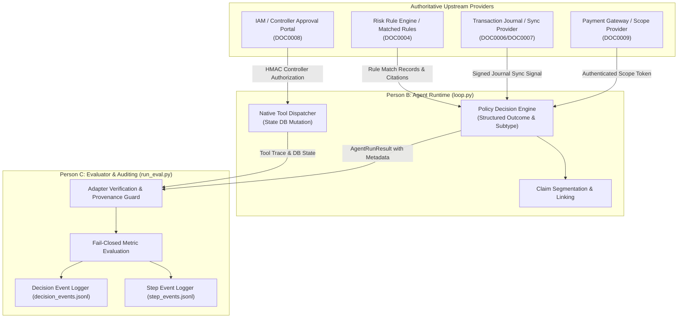
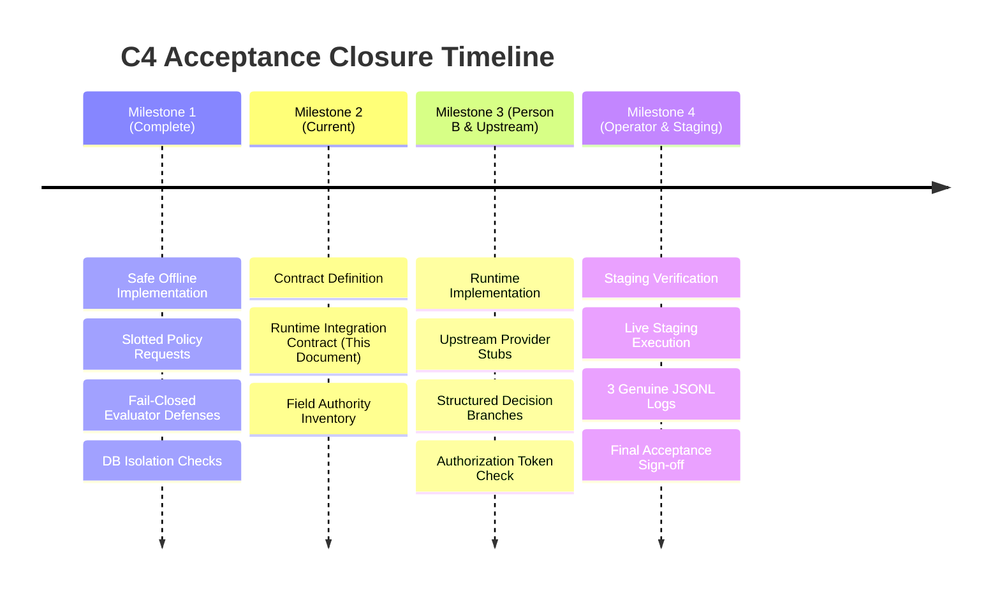

# C4 Runtime Integration Contract and Upstream Interface Specification

**Document Version:** 1.0.0 (C4-FINAL-12)
**Status:** DRAFT / PROPOSED FOR ARCHITECTURE & RUNTIME IMPLEMENTATION
**Primary Stakeholders:**
- Person B (Agent & Tool/MCP Owner, `src/trfc/agent/`, `src/trfc/tools/`, `src/trfc/mcp_server/`)
- Person C (Measurement & Evaluator Owner, `eval/`, `tests/`, `reports/`)
- Upstream Risk & Core Banking Platform Owners (Payment gateway, transaction journal, risk engine, IAM/Controller portal)
- Authorized Staging Operator (Staging validation, execution of authentic testset scenarios)

---

## 1. Executive Summary & Purpose

The TRFC Fraud AML Agent project enforces strict policy-driven decisions regarding fraud detection, AML investigations, temporary account freezing, suspicious transaction flagging, and query refusals. Under the authoritative C4 acceptance criteria (`PHAN_CONG.md §4`), the agent must provide verified auditability, reproducible evaluations, and authentic execution evidence.

To date, offline evaluator defenses, dataclass contracts, fail-closed handlers, and tool-level database isolation have been verified. However, **C4 cannot be marked complete** because:
1. The runtime (`src/trfc/agent/loop.py`) operates as a free-form ReAct loop driven by Groq LLM completions without emitting machine-readable structured policy decisions (`actual_outcome`, `actual_refusal_type`, `policy_rule_id`, `decision_source`, `claims`).
2. Authoritative upstream business signals (payment-method classifications, log synchronization/retention proofs, controller authorization signatures, and risk-rule engine evaluations) are absent from runtime tools.
3. Authentic end-to-end evidence logs (`logs/*.jsonl` with 1 freeze, 1 flag, and 1 refusal) do not exist.

This document establishes the **binding runtime integration contract** required between Person B's runtime and upstream providers to resolve these blockers without resorting to ungrounded LLM guessing or synthetic metadata fabrication.

---

## 2. Five Architectural Invariants

All interfaces in this contract must satisfy five non-negotiable architectural invariants:

1. **Fail-Closed by Default:** Missing, unauthenticated, stale, or contradictory upstream inputs must yield `status="needs_information"` (or `status="unscorable"` in evaluation) with decision fields strictly cleared to `None`. Under no circumstance may the agent default an unknown method to a supported one or treat missing logs as normal activity.
2. **Strict Separation of Capture vs. Authority (Five-Tier Provenance):**
   - *Tier 1 (Capture records):* Tool traces, retrieved contexts, and token usage prove only what was observed or requested. They are not business decisions.
   - *Tier 2 (Provisional metadata):* Unverified candidate fields.
   - *Tier 3 (Evaluator testset labels):* Expected ground-truth values used strictly for testing. They must never be injected into runtime decisions.
   - *Tier 4 (Offline deterministic contract):* Validated synthetic contract instances used for regression tests.
   - *Tier 5 (Authoritative business decisions):* Authenticated outputs from verified upstream providers or signed IAM authorizations.
3. **Immutability and Subclass Rejection:** All request and decision contracts must use frozen, slotted structures (`@dataclass(frozen=True, slots=True)`). Exact type identity must be validated (`type(req) is ExpectedClass`) to prevent subclass spoofing or dynamic field injection.
4. **Structured Decision / Text Decoupling:** Business outcomes (`answer` vs. `refusal`) and refusal subtypes (`i` vs. `ii`) must be determined by explicit deterministic policy branches or structured provider outputs, never parsed or inferred from natural-language LLM prose.
5. **Traceable Run ID and Sanitized Logging:** Every runtime execution must generate a unique, opaque `run_id` (UUIDv4) and UTC timestamp, propagate it across all emitted step events and decision events, and pass all records through recursive redaction (`eval.redaction.redact_for_log`) prior to JSONL persistence.

---

## 3. Upstream Provider Interfaces



---

### Interface 1: Authenticated Payment-Method Scope Classifier (DOC0009)

* **Business Policy:** `DOC0009.md` Arts. 1–5. Transactions or inquiries involving unsupported payment methods (outside PM01–PM04) must be definitively refused as out-of-scope (Refusal Type `i`).
* **Owner:** Upstream Payment Gateway / Platform Services.
* **Consuming Component:** `src/trfc/agent/loop.py` / `src/trfc/agent/policy.py`.
* **Input Schema:**
  ```python
  @dataclass(frozen=True, slots=True)
  class PaymentMethodScopeQuery:
      method_identifier: str       # e.g., "MOMO", "ZALOPAY", "CRYPTO", "PM01"
      channel: str                 # "mobile_app", "web", "pos", "api"
      observation_timestamp: str   # ISO-8601 UTC
  ```
* **Output Contract:**
  ```python
  @dataclass(frozen=True, slots=True)
  class AuthenticatedPaymentMethodScope:
      method_code: str             # "PM01", "PM02", "PM03", "PM04", or "OUT_OF_SCOPE"
      is_supported: bool           # True iff method_code in PM01-PM04
      doc_citation: str            # "DOC0009"
      article_citation: str        # e.g., "Art. 3" or "Art. 5"
      provider_signature: str      # HMAC-SHA256 signature by payment gateway authority
      signed_at: str               # ISO-8601 UTC
  ```
* **Validation & Integrity Requirements:**
  - `observation_timestamp` and `signed_at` must not be older than 300 seconds relative to runtime clock.
  - `provider_signature` must be verified using the upstream service public key / HMAC secret.
  - `method_code` must match the closed vocabulary defined in DOC0009.
* **Failure & Fail-Closed Behavior:**
  - If the query fails, signature is invalid, timestamp is stale, or output is unauthenticated: runtime sets `policy_decision_status="needs_information"`, `policy_reason_code="payment_method_provenance_unverified"`, and outcome remains `None`.
  - If `is_supported is False`: runtime deterministically selects Refusal Type `i`, setting `actual_outcome="refusal"`, `actual_refusal_type="i"`, `policy_rule_id="DOC0009_ART05"`, `decision_source="upstream.payment_gateway"`.
* **Test & Acceptance Evidence:**
  - Contract test verifying signature check failure yields `needs_information`.
  - Regression test proving known out-of-scope method yields Refusal Type `i`.

---

### Interface 2: Transaction Log Completeness & Synchronization Provider (DOC0006 / DOC0007)

* **Business Policy:** `DOC0001` Art. 3, `DOC0006` Arts. 7 & 12, `DOC0007` Art. 12. Inability to evaluate due to missing, purged, or desynchronized transaction logs must be classified as Refusal Type `ii` ("insufficient data"), not treated as a normal/cleared state.
* **Owner:** Core Banking Core Journal / Data Replication Platform.
* **Consuming Component:** `src/trfc/tools/impl.py` (`get_transactions`) and `src/trfc/agent/loop.py`.
* **Input Schema:**
  ```python
  @dataclass(frozen=True, slots=True)
  class JournalSyncQuery:
      account_id: str
      query_start: str             # ISO-8601 UTC
      query_end: str               # ISO-8601 UTC
  ```
* **Output Contract:**
  ```python
  @dataclass(frozen=True, slots=True)
  class AuthenticatedJournalSyncStatus:
      account_id: str
      sync_status: str             # "synchronized", "sync_lag_exceeded", "partition_error"
      retention_status: str        # "complete", "purged_after_retention_period", "unretained"
      oldest_available_record: str # ISO-8601 UTC
      newest_available_record: str # ISO-8601 UTC
      missing_ranges: list[tuple[str, str]] # List of gaps [start, end]
      attestation_token: str       # Cryptographic journal attestation
      issued_at: str               # ISO-8601 UTC
  ```
* **Validation & Integrity Requirements:**
  - `issued_at` within 60 seconds of execution.
  - `attestation_token` verified against database replication authority.
  - `retention_status` must explicitly distinguish between "no transactions occurred" and "logs were purged per DOC0006 5-year retention rules".
* **Failure & Fail-Closed Behavior:**
  - If `sync_status != "synchronized"` or `missing_ranges` is non-empty: runtime must NOT infer a clean transaction history. It must emit Refusal Type `ii`, setting `actual_outcome="refusal"`, `actual_refusal_type="ii"`, `policy_rule_id="DOC0007_ART12"`, `decision_source="upstream.core_journal"`.
  - If the provider is unreachable or attestation fails: runtime sets `policy_decision_status="needs_information"`, `policy_reason_code="transaction_log_provenance_unverified"`.
* **Test & Acceptance Evidence:**
  - Unit test proving empty log with `sync_status="sync_lag_exceeded"` returns Refusal Type `ii` and never `actual_outcome="answer"`.

---

### Interface 3: Authoritative Risk Rule Engine (DOC0004)

* **Business Policy:** `DOC0004.md` Arts. 2–12. Risk rules (daily limit excess, geographic impossibility, velocity anomalies, transaction splitting) must be computed by a deterministic risk-rule engine. Citation of DOC0004 in prompt context is only retrieval capture; it does not prove a rule matched.
* **Owner:** Upstream AML / Fraud Risk Platform.
* **Consuming Component:** `src/trfc/agent/loop.py` / `src/trfc/tools/`.
* **Input Schema:**
  ```python
  @dataclass(frozen=True, slots=True)
  class RiskEvaluationPayload:
      account_id: str
      transaction_id: str
      ekyc_tier: int               # 1, 2, or 3 (verified from accounts table)
      tx_history: list[dict]       # Validated complete transactions
      current_tx: dict             # Amount, timestamp, location, counterparty
  ```
* **Output Contract:**
  ```python
  @dataclass(frozen=True, slots=True)
  class AuthoritativeRiskAssessment:
      account_id: str
      transaction_id: str
      evaluation_status: str       # "evaluated", "insufficient_history", "eval_error"
      matched_rules: list[str]     # e.g., ["R01_DAILY_LIMIT", "R03_GEO_IMPOSSIBILITY"]
      rule_descriptions: list[str]
      recommended_action: str      # "none", "flag_suspicious_tx", "freeze_account"
      excess_ratio: float | None   # Required if R01 triggered (DOC0008 Art. 4)
      engine_version: str          # e.g., "trfc-risk-v2.1"
      evaluation_signature: str    # Digital signature of evaluation engine
      evaluated_at: str            # ISO-8601 UTC
  ```
* **Validation & Integrity Requirements:**
  - `evaluation_status` must be `"evaluated"` before any matched rule can be consumed.
  - `matched_rules` identifiers must conform to `^[A-Za-z0-9_.:-]{1,64}$`.
  - If `recommended_action == "freeze_account"`, `excess_ratio` must be non-null and greater than 0.0.
* **Failure & Fail-Closed Behavior:**
  - If `evaluation_status == "insufficient_history"`, runtime triggers Refusal Type `ii`.
  - If `matched_rules` is empty and `evaluation_status == "evaluated"`, runtime emits `actual_outcome="answer"` with no flag/freeze tool call.
  - If the risk engine is offline or signature invalid: `policy_decision_status="needs_information"`.
* **Test & Acceptance Evidence:**
  - Integration test demonstrating that regex-matching DOC0004 in RAG retrieval without an `AuthoritativeRiskAssessment` record yields `decision_source=None`.

---

### Interface 4: Authenticated Controller Approval & Identity Portal (DOC0008)

* **Business Policy:** `DOC0008.md` Arts. 2–6, 12. An account freeze operation (`freeze_account_temporarily`) has severe business and legal consequences. Under DOC0008, an alert alone does NOT authorize a freeze; only an authorized controller with valid credentials, original alert ID, and documented excess ratio may approve an account freeze.
* **Owner:** Enterprise IAM / Compliance Controller Portal.
* **Consuming Component:** `src/trfc/tools/impl.py` (`freeze_account_temporarily`) & `src/trfc/agent/loop.py`.
* **Input Schema:**
  ```python
  @dataclass(frozen=True, slots=True)
  class FreezeAuthorizationToken:
      controller_id: str           # Unique identifier of compliance officer
      controller_role: str         # Must be "COMPLIANCE_CONTROLLER" or "AML_SUPERVISOR"
      alert_id: str                # ID of upstream alert triggering this action
      target_account_id: str       # Target account to freeze
      excess_ratio: float          # Verified excess ratio (> 0.0)
      reason_code: str             # Standardized reason code
      valid_until: str             # ISO-8601 UTC (must be in future)
      hmac_signature: str          # HMAC-SHA256 signature issued by IAM portal
  ```
* **Validation & Integrity Requirements:**
  - `freeze_account_temporarily` must require `auth_token: FreezeAuthorizationToken`.
  - `valid_until` must be strictly after the current UTC timestamp.
  - `controller_role` must be within authorized roles.
  - `target_account_id` in the token must match the tool call's `account_id` exactly.
* **Failure & Fail-Closed Behavior:**
  - If `auth_token` is missing, expired, role unauthorized, or HMAC invalid: tool execution returns `"Error: Unauthorized freeze attempt - missing or invalid controller authorization token"` and does NOT mutate SQLite.
  - Runtime captures tool failure and records `status="failed"` or `policy_decision_status="needs_information"`.
* **Test & Acceptance Evidence:**
  - Test verifying that calling `freeze_account_temporarily` with a free-form string reason without an authenticated token fails and leaves `accounts.is_frozen == 0`.

---

## 4. Runtime Emission Contracts (Person B -> Evaluator)

To satisfy C4, Person B's runtime must emit structured fields in `AgentRunResult` from verified decision points in `loop.py`:

```python
@dataclass
class AgentRunResult:
    answer: str | None = None
    actual_outcome: str | None = None           # "answer" or "refusal"
    actual_refusal_type: str | None = None      # "i" or "ii" (strictly null if outcome != "refusal")
    policy_rule_id: str | None = None           # e.g., "DOC0009_ART05", "DOC0007_ART12"
    decision_source: str | None = None          # Safe structured identifier (e.g. "upstream.payment_gateway")
    contexts: list[str] | None = None           # Captured valid retrieval passages
    claims: list[str] | None = None             # Explicit answer claim spans
    tool_trace: list[dict[str, Any]] | None = None
    usage: dict[str, int | None] | None = None
    status: str = "failed"                      # "completed", "unscorable", "failed"
    error: str | None = None
    policy_decision_status: str | None = None   # "decided" or "needs_information"
    policy_reason_code: str | None = None
```

### Claim Spans & Source Provenance
When faithfulness scoring is required by the evaluation suite:
1. `claims` must be provided as a `list[str]` containing exact substrings of `answer`.
2. Claims must be generated by a validated claim-segmentation component (not guessed or inferred from testset labels).
3. If claim segmentation is unavailable, Person B's runtime must set `claims=None`, allowing faithfulness to be marked `unscorable` rather than falsifying a score.

---

## 5. Decision Event Logging Schema

When `actual_outcome` and `decision_source` are populated, the evaluation pipeline writes a dedicated record to `decision_events.jsonl` matching this validated schema:

```json
{
  "record_type": "decision_event",
  "timestamp": "2026-10-14T12:00:00Z",
  "run_id": "4b5d2a89c894458fbc8d89006efcf21a",
  "question_id": "case_01",
  "execution_mode": "real",
  "actual_outcome": "refusal",
  "actual_refusal_type": "i",
  "policy_rule_id": "DOC0009_ART05",
  "decision_source": "upstream.payment_gateway",
  "tool_trace_status": "complete",
  "tool_call_count": 2,
  "business_outcome_verified": false
}
```

---

## 6. Actionable Dependency & Handoff Matrix

| Stakeholder / Owner | Specific Deliverable | Blocking Upstream Dependency | Acceptance Verification Method | Acceptance Evidence Required |
|---|---|---|---|---|
| **Person B (Agent / Runtime Owner)** | Structured decision branches in `src/trfc/agent/loop.py` populating `actual_outcome`, `actual_refusal_type`, `policy_rule_id`, and `decision_source`. | Interfaces 1, 2, and 3 from Upstream Platform. | Offline unit tests with mock providers (`tests/test_agent_adapter.py`). | `run_detailed()` returns populated fields without altering `run(question) -> str`. |
| **Person B (Agent / Runtime Owner)** | Token-based authorization check in `freeze_account_temporarily` (`src/trfc/tools/impl.py`). | Interface 4 from IAM Portal. | Unit test verifying invalid token rejects freeze without database mutation. | DB assertion: `accounts.is_frozen == 0` on unauthorized attempt. |
| **Upstream Platform / Services** | Authenticated Payment Scope API (DOC0009). | Banking core gateway specification. | Contract test against staging gateway endpoint. | Signed scope token with HMAC verification. |
| **Upstream Platform / Services** | Transaction Journal Sync API (DOC0006/0007). | Core database replication logs. | Attestation token validation test. | Cryptographic retention/sync status payload. |
| **Upstream Platform / Services** | Risk Rule Engine (DOC0004). | Fraud detection rule base. | Rule match integration test. | Evaluation signature and rule match list. |
| **Authorized Staging Operator** | 3 genuine end-to-end evaluation runs (1 freeze, 1 flag, 1 refusal) logged to `logs/*.jsonl`. | Person B runtime integration and live staging LLM/DB credentials. | `eval/log_validation.py` validation over all 3 log files. | Complete JSONL files in `logs/` with verified SQLite state readback. |

---

## 7. Blocker Resolution Roadmap



Until Milestone 3 and Milestone 4 deliverables are produced and verified by their designated owners, overall C4 acceptance remains strictly **BLOCKED**.
